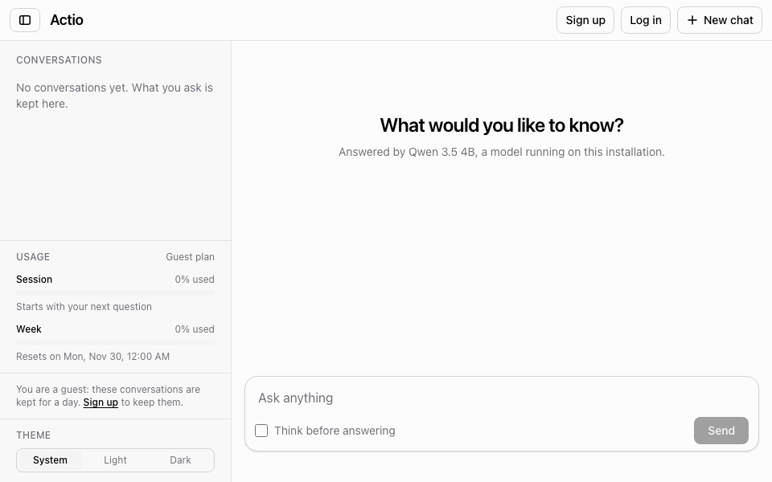

# Actio

[](https://github.com/fatihrime/actio/actions/workflows/ci.yml)

> A self-hostable, local-first AI platform: a ChatGPT/Claude-style assistant and an OpenAI- and Anthropic-compatible developer gateway, both governed by Claude-inspired usage limits whose correctness is tested.



_A local model of 4 billion parameters on a 16 GB laptop, recorded by `make demo-record`: the page as the browser painted it, with waits longer than a second and a half shortened._

**Status:** Phase 1 of 7 is done, as `v0.2.0`: a chat on local models, with accounts and usage limits. `make up`, open <http://localhost:8080>, and ask. Answers are formatted, with code, formulas and diagrams, and your conversations are listed beside the chat, to open, rename and delete. A guest can sign up and keep them, and log in again from anywhere. Every answer is held to usage limits, per session and per week, and the page shows them: a meter, the time left when a limit is reached, and a model that costs nothing to carry on with, where one is offered. An answer is written at the server whether or not its page stays open, and only Stop ends it. Answers wait their turn for a local model that writes one at a time, and an account has only so many being written at once. Under each answer the page says what it took: how fast the model wrote, how soon its first word came, and what it cost. Under the box it says how full the model's context window is. The model is loaded ahead of the first question, and the page is light or dark as you choose. A conversation you left while reading an older part of it opens there again, after a reload of the page too. Phase 2 is next: the model router and the developer gateway. This README grows with each phase, and nothing below counts as done until it ships with tests.

**Documentation:** <https://fatihrime.github.io/actio/>: getting started, architecture, development and the decision records.

## Why Actio?

Running an LLM on your own machine is easy. Running it well for several people is harder:

- one machine has to be shared fairly;
- long jobs have to survive restarts;
- traffic has to route around a provider that's down;
- usage limits have to hold under load, provably.

Actio tackles these problems end to end on a 16 GB laptop and free tiers.

## What v1 will do

- **Local chat** on Ollama: streaming, a reasoning display and branching conversations.
- **Usage limits inspired by Claude:**
  - a rolling 5-hour session plus a weekly limit;
  - integer credits;
  - atomic reservations in Valkey, with a Postgres ledger as the source of truth.
- **Developer gateway:** OpenAI- and Anthropic-compatible endpoints with personal API keys. Coding agents can run on local models, metered by the same limits.
- **Knowledge:** document Q&A and web search, with citations.
- **Channels:**
  - a Telegram assistant;
  - a WhatsApp support bot for a fictional bike shop;
  - a race-free message pipeline with human takeover.
- **Video generation:** durable background jobs on serverless GPUs.

## Engineering highlights

- **Usage limits that are tested, not just plausible.**
  - The engine runs as Lua scripts inside Valkey, so two requests at the same moment can never both take the last credits.
  - A plain-Python reference model is its specification. Random sequences of requests, crashes, clock jumps and data loss run against both, and their results and stored state must match after every step.
  - In the chat's API, an answer's credits are held before a model is asked, and what it used is written to a ledger in Postgres before the counters hear of it. Valkey keeps nothing on disk: restart it, and every account's limits are counted up again from the ledger. A question that doesn't fit is refused before it is stored.
  - Measured: guessing a prompt's size from its bytes came out at under half for a page of numbers, because the model reads every digit as a token. So the guess counts digits one by one, and the provider's own count settles the bill.
  - The page counts nothing itself. It shows what the server counted, and learns that a limit is reached by being refused; the time to wait is taken from the length of the wait, not from a clock that may be wrong. A test in a real browser reaches a limit, carries on with a free model, and reloads to the same counts.
  - [The engine (ADR 0006)](docs/adr/0006-usage-limits-engine.md) · [in the chat's API (ADR 0020)](docs/adr/0020-usage-limits-on-turns.md) · [in the page (ADR 0021)](docs/adr/0021-usage-limits-in-the-page.md) · [the rules](https://fatihrime.github.io/actio/reference/quota/) · [the tests](packages/quota/tests)

- **A local-model client that never answers from half your prompt.**
  - Measured: Ollama has two engines. By default, one cuts a prompt that doesn't fit the model's context window, system prompt included, and still answers as if nothing happened. The other ignores the window and lets an answer run on: a small model thought for three minutes to say hello.
  - Actio's adapter makes the first refuse such a prompt with a clear error, and gives every answer a limit on both.
  - Its tests replay exchanges recorded from a real server, and live tests pin what each engine really does. With the strict settings removed, they fail.
  - [The design (ADR 0007)](docs/adr/0007-local-models-through-ollamas-native-api.md) · [what it guarantees](https://fatihrime.github.io/actio/reference/llm/) · [the tests](packages/llm/tests)

- **An answer is written at the server, whoever is watching.**
  - A turn runs apart from the request that started it. Close the tab, reload, or open a second window: the answer goes on, and a page that comes back reads along with it. Only Stop ends one.
  - A turn that is being written says so every fifteen seconds, and saves what it has written with it. When its process dies, what it had written is kept as the answer, and nothing goes on looking busy.
  - A local model writes one answer at a time, so answers wait their turn, and an account has only so many being written at once. Told to stop, the server lets the answers that are being written finish, or ends them while their readers are still connected.
  - [Turns apart from their request (ADR 0022)](docs/adr/0022-turns-that-run-apart-from-their-request.md) · [answers that wait their turn (ADR 0023)](docs/adr/0023-answers-that-wait-their-turn.md) · [background jobs in Postgres (ADR 0024)](docs/adr/0024-background-jobs-in-a-queue-in-postgres.md)

- **A page whose speed is measured, in three browser engines.**
  - Every phase ends with a performance run in Chromium, Firefox and WebKit, against numbers the project holds itself to: no frame longer than 50 ms while an answer of 4,000 words arrives at 300 words a second, and a box that can be typed into within 0.3 s of a first visit on a desktop. At the end of Phase 1 that took 0.11 s, and 1.9 s on a phone profile, which is a CPU slowed four times on slow 4G.
  - The runs found what using the page had not: frames of 0.8 and 0.6 s at the first block of TypeScript in Safari's engine, a long conversation that opened as one uninterrupted render, and a query that read a conversation again at every step of walking it, 360,000 rows for 600 messages.
  - A run can mislead too. One reported a click as slow that was slow only in the test's own driver, and the page on performance says so.
  - [How a run is made, the numbers, and what the runs found](https://fatihrime.github.io/actio/performance/)

_More are added as each piece ships, with links to the design records (ADRs), tests and measurements._

## The numbers so far

Measured at the end of Phase 1 on an Apple M1 Pro with 16 GB: the production build in containers, with a fake model that answers at a set speed, so that the page and the API are measured and not a model. [How they are measured, and the rest of them](https://fatihrime.github.io/actio/performance/).

| | |
|---|---|
| A first visit on a desktop, until the box can be typed into | 0.11 s |
| The same on a phone profile: the CPU slowed four times, on slow 4G | 1.9 s |
| Transferred on a first visit | 0.5 MB, in 20 requests |
| The longest frame while 4,000 words arrive at 300 a second | 17 ms in Chromium, 9 to 41 ms in Firefox, 31 to 54 ms in WebKit over twelve runs on a busy machine, 41 ms in the middle |
| A key typed beside an arriving answer, until it is shown, 95 times of 100 | within 17 to 19 ms in Chromium, 6 to 7 ms in Firefox, 17 ms in WebKit |
| 50 answers started at once: the first word of each | within 0.7 s for 95 of 100, none refused |
| A conversation of 600 messages, read whole | 37 to 38 ms |
| Memory of the stack's six containers at rest, without a model's server | 373 MiB |
| Tests | 1,607 in Python, 679 of the web app, 76 end to end in a real browser |

## Quickstart

**Just run it,** on macOS or Linux. You need only Docker, `make` and `openssl`:

```sh
git clone https://github.com/fatihrime/actio.git && cd actio
make up   # builds and starts every service in containers; open http://localhost:8080
```

To chat, it needs a model: install [Ollama](https://ollama.com) and run `ollama pull qwen3.5:4b-q4_K_M` (3.3 GB). Until then the page says what is missing. See [getting started](https://fatihrime.github.io/actio/getting-started/#models).

**Develop it,** on macOS with [Docker Desktop](https://docs.docker.com/desktop/). The API and the web app run natively, with hot reload:

```sh
make bootstrap   # checks your tools, installs everything, creates .env with random passwords
make dev         # starts the stack; open http://localhost:8080
```

`make smoke` checks a running stack, and `make down` stops it. CI runs the `make up` quickstart on Linux for every change.

## Roadmap

| Phase | Scope | Status |
|---|---|---|
| 0 | Foundation: repo, tooling, CI, docs | done |
| 1 | Local chat + usage limits | done, `v0.2.0` |
| 2 | Model router + developer gateway | planned |
| 3 | Core chat UX | planned |
| 4 | Knowledge + web search | planned |
| 5 | Telegram + WhatsApp | planned |
| 6 | Video pipeline | planned |
| 7 | Hardening + v1.0 | planned |

**After v1:**
- memory and projects;
- artifacts and code analysis;
- MCP connectors and deep research;
- image generation;
- voice;
- file creation.

## How this project is built

Actio is built from scratch with AI assistance (Claude Code).
- Every change is small and tested, and I review and commit each one myself.
- Design decisions are recorded in [`docs/adr/`](docs/adr/).
- [How AI is used](https://fatihrime.github.io/actio/ai-workflow/) explains the workflow, and how the assistant's work is checked.

## License

[MIT](LICENSE)
