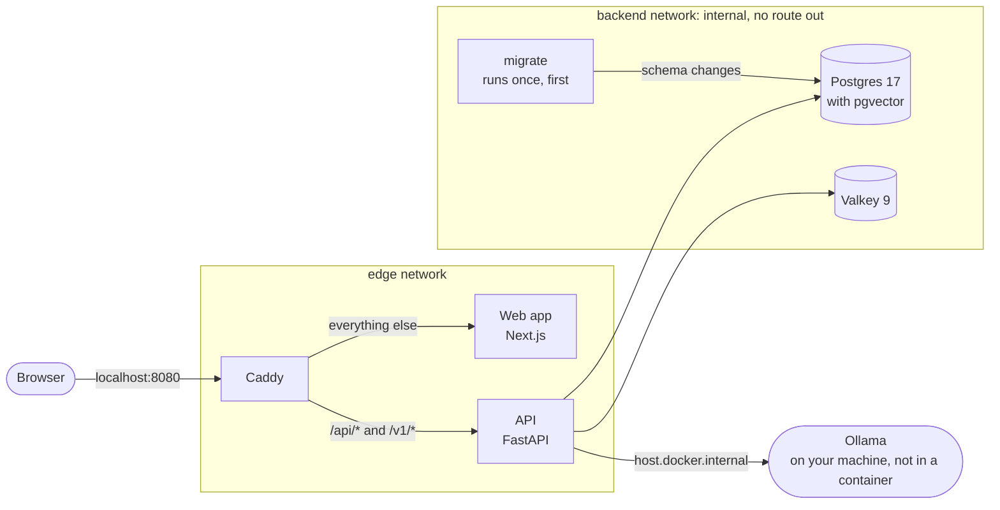

# Architecture

## Today

`make up` runs five containers behind one address, <http://localhost:8080>, after a sixth, `migrate`, has brought the database schema up to date and exited:

- **Caddy** is the only entry point, and the only container with a port on your machine. It sends `/api/*` and `/v1/*` to the API, and every other path to the web app. It passes streamed responses through at once, which the chat's token-by-token replies need.
- **The API** is one Python application, `actio`, built on FastAPI. It runs as several processes from the same code, chosen with `--role`: `api` serves HTTP, and `migrate` applies database migrations and exits ([ADR 0008](adr/0008-postgres-through-sqlalchemy-and-psycopg.md)). Today the API serves its interactive docs, two probes, guest sessions and accounts:
    - `/api/healthz` answers whenever the process is alive;
    - `/api/readyz` answers 200 only when the database is reachable and migrated and Valkey answers. Otherwise it answers 503 and names what is missing;
    - `POST /api/session/guest` starts a session as a new guest and sets its cookie, `GET /api/me` says who the cookie belongs to, and `DELETE /api/session` ends it ([ADR 0009](adr/0009-sessions-in-the-database.md));
    - `POST /api/account` turns a guest into a lasting account with an email address and a password, `POST /api/session` logs in, `PUT /api/account/password` changes the password, and `DELETE /api/sessions` logs out of every browser ([ADR 0010](adr/0010-accounts-with-a-password.md));
    - new guests, sign-ups and password attempts are rate-limited. Past a limit, the answer is 429 with a `Retry-After` header ([ADR 0011](adr/0011-rate-limits-as-token-buckets-in-valkey.md));
    - `GET /api/conversations` lists your conversations a page at a time, and `GET /api/conversations/{id}` returns one with its messages. `PATCH` renames it, `DELETE` deletes it, and `PUT …/branch` shows another version of a question or an answer ([ADR 0012](adr/0012-conversations-as-a-tree-of-messages.md));
    - `POST /api/conversations/{id}/turns` puts a question to a model and streams the answer back, piece by piece, in the format the AI SDK reads. The first question creates the conversation. The same route rewords an earlier question, or asks for another answer. Each turn is recorded: which model, how it ended, what it cost in tokens and time ([ADR 0014](adr/0014-turns-streamed-in-the-ai-sdks-format.md));
    - `GET /api/models` lists the models on offer, from `config/models.toml`, and says whether each can answer right now: `ready`, `missing` from its server, or its server `unreachable` ([ADR 0013](adr/0013-the-models-on-offer-are-a-file.md)).
- **Ollama** runs the local models. It runs on your machine itself, where it can use the graphics processor, and the API reaches it from its container.
- **The web app** is a Next.js application: the chat ([ADR 0015](adr/0015-the-web-chat-calls-the-api-from-the-browser.md)).
    - **Its server sends only the frame of the page.** Everything of yours is fetched by the browser, straight from the API, with the session cookie. Nothing but the API handles a session.
    - **A first visit starts a guest session,** so you can ask at once. `/` is a new conversation, and `/c/<id>` a stored one.
    - **The list of your conversations is beside the chat,** to open, rename and delete them. The page reads it from the API again after every turn, and never rearranges it by itself ([ADR 0018](adr/0018-the-list-of-conversations-is-the-servers.md)).
    - **An answer streams into the page** through the AI SDK's `useChat`. You can stop it, try a failed one again, reword a question that got no answer, and have the model show its reasoning.
    - **The server is the truth.** When an answer ends any other way than well, the page reads the conversation again and shows what is stored.
    - **An answer is shown as the markdown it is written in:** headings, tables, coloured code, formulas and diagrams. It is a model's text, so it can do nothing else: HTML in it is shown as text, no picture is fetched, and a link opens only after you have seen its address ([ADR 0016](adr/0016-answers-shown-as-markdown.md)).
    - **Its types for the API are generated** from the API's recorded description, `apps/api/openapi.json`, so a change to the API that the page doesn't follow fails to compile.
- **Postgres and Valkey** sit on an internal network. Only the API and the migration job can reach them, and they can't reach the internet. The API connects to both.
    - Postgres holds five tables: accounts, their sessions, conversations, the messages of each conversation, which form a tree, and the turns in which a model answered.
    - Valkey holds the rate limits' counters: one number per client address or email address that has made an attempt lately, under a hashed name.

Inside the API, the code is split into layers that only import downward, and a tool enforces it:

| Layer | Holds |
|---|---|
| `actio.api` | The HTTP interface: routes, the session cookie, the check against requests from other sites, which attempts are rate-limited, the error format. The only layer that knows the web framework |
| `actio.chat` | Conversations, their tree of messages, and turns: starting one, following a model's answer as it streams, recording how it ended. Tables and rules, with no HTTP |
| `actio.catalog` | The models on offer: reading `config/models.toml`, and asking a model's server about it |
| `actio.identity` | Accounts and sessions: tables and rules, with no HTTP |
| `actio.core` | Settings, ids, the database connection and its migrations, the rate limiter |

| Path | Goes to |
|---|---|
| `/api/*` | The API: Actio's own endpoints, such as `/api/healthz` and `/api/docs` |
| `/v1/*` | The API: the gateway compatible with OpenAI and Anthropic (planned) |
| Everything else | The web app |

## Two ways to run it

- **`make up`** runs everything in containers, shaped like production. See [ADR 0005](adr/0005-container-images.md).
- **`make dev`** runs only Postgres, Valkey and Caddy in containers. The API and the web app run natively with hot reload, and Caddy reaches them through Docker Desktop. See [ADR 0004](adr/0004-local-development-stack.md).

## Security rules

The containers follow the same rules in both modes. Tests in `deploy/tests/` check them on every change:

- only Caddy publishes a port, and only on 127.0.0.1;
- every image is pinned by digest, including the base images of the images Actio builds;
- the data services sit only on the internal network;
- every container runs as a non-root user, on a read-only filesystem, without Linux capabilities, with a memory limit and a health check.

## Planned

The next phases add:

- **a worker process,** the same Python application run with `--role worker`, which takes background jobs from a queue in Postgres ([ADR 0001](adr/0001-one-app-several-process-roles.md));
- **more of the chat:** pages to sign up and log in. Today everyone is a guest, whose conversations last a day;
- **turns that outlive their request:** today an answer stops when its reader leaves, or opens another conversation. Later a turn runs on its own, and a reader who comes back picks the stream up again;
- **more providers:** cloud models behind a router with fallbacks. In tests, [fakellm](reference/fakellm.md) stands in for all of them;
- **usage limits:** session and weekly windows, enforced atomically in Valkey and recorded in a Postgres ledger. The [engine](reference/quota.md) already exists as a package, tested against a real Valkey server ([ADR 0006](adr/0006-usage-limits-engine.md)). Connecting it to the API, with the ledger, is still to come.

## Repository layout

| Path | Contents |
|---|---|
| `apps/api` | The Python application: the API today, plus the worker later |
| `apps/web` | The Next.js web app: the chat's pages and components, its calls to the API, and their tests |
| `packages/fakellm` | A fake LLM server for tests, scripted by directives in the prompt |
| `packages/llm` | Model clients: a neutral chat format, adapters for Ollama and for OpenAI-compatible servers, and the `actio-llm` command |
| `packages/quota` | The usage-limits engine: Lua scripts for Valkey, and the Python reference model they're tested against |
| `compose.yaml`, `compose.dev.yaml` | The stack for `make up`, and the overlay for `make dev` |
| `config/` | What an installation changes without touching code. Today: `models.toml`, the models on offer |
| `deploy/` | Caddy's configuration, and the tests for the containers' rules |
| `docs/` | This site, including the decision records |
| `scripts/` | Developer scripts: tool checks, the denylist hook, the smoke test |
