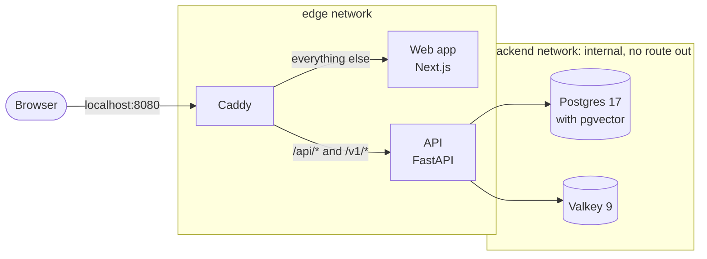

# Architecture

## Today

`make up` runs five containers behind one address, <http://localhost:8080>:

- **Caddy** is the only entry point, and the only container with a port on your machine. It sends `/api/*` and `/v1/*` to the API, and every other path to the web app. It passes streamed responses through at once, which the chat's token-by-token replies will need.
- **The API** is one Python application, `actio`, built on FastAPI. It will run as several processes from the same code, chosen with `--role`. Today it serves its health check and interactive docs.
- **The web app** is a Next.js application. Today it is a placeholder page.
- **Postgres and Valkey** sit on an internal network. Only the API can reach them, and they can't reach the internet. Nothing stores data in them yet.

| Path | Goes to |
|---|---|
| `/api/*` | The API: Actio's own endpoints, such as `/api/healthz` and `/api/docs` |
| `/v1/*` | The API: the gateway compatible with OpenAI and Anthropic (planned) |
| Everything else | The web app |

## Two ways to run it

- **`make up`** runs everything in containers, shaped like production. See [ADR 0005](adr/0005-container-images.md).
- **`make dev`** runs only Postgres, Valkey and Caddy in containers. The API and the web app run natively with hot reload, and Caddy reaches them through Docker Desktop. See [ADR 0004](adr/0004-local-development-stack.md).

## Security rules

The containers follow the same rules in both modes. Tests in `deploy/tests/` check them on every change:

- only Caddy publishes a port, and only on 127.0.0.1;
- every image is pinned by digest, including the base images of the images Actio builds;
- the data services sit only on the internal network;
- every container runs as a non-root user, on a read-only filesystem, without Linux capabilities, with a memory limit and a health check.

## Planned

The next phases add:

- **a worker process,** the same Python application run with `--role worker`, which takes background jobs from a queue in Postgres ([ADR 0001](adr/0001-one-app-several-process-roles.md));
- **models:** Ollama on your machine for local models, and cloud providers behind a router with fallbacks. In tests, [fakellm](reference/fakellm.md) stands in for all of them;
- **usage limits:** session and weekly windows, enforced atomically in Valkey and recorded in a Postgres ledger. The [engine](reference/quota.md) already exists as a package, tested against a real Valkey server ([ADR 0006](adr/0006-usage-limits-engine.md)). Connecting it to the API, with the ledger, is still to come.

## Repository layout

| Path | Contents |
|---|---|
| `apps/api` | The Python application: the API today, plus the worker later |
| `apps/web` | The Next.js web app |
| `packages/fakellm` | A fake LLM server for tests |
| `packages/quota` | The usage-limits engine: Lua scripts for Valkey, and the Python reference model they're tested against |
| `compose.yaml`, `compose.dev.yaml` | The stack for `make up`, and the overlay for `make dev` |
| `deploy/` | Caddy's configuration, and the tests for the containers' rules |
| `docs/` | This site, including the decision records |
| `scripts/` | Developer scripts: tool checks, the denylist hook, the smoke test |
