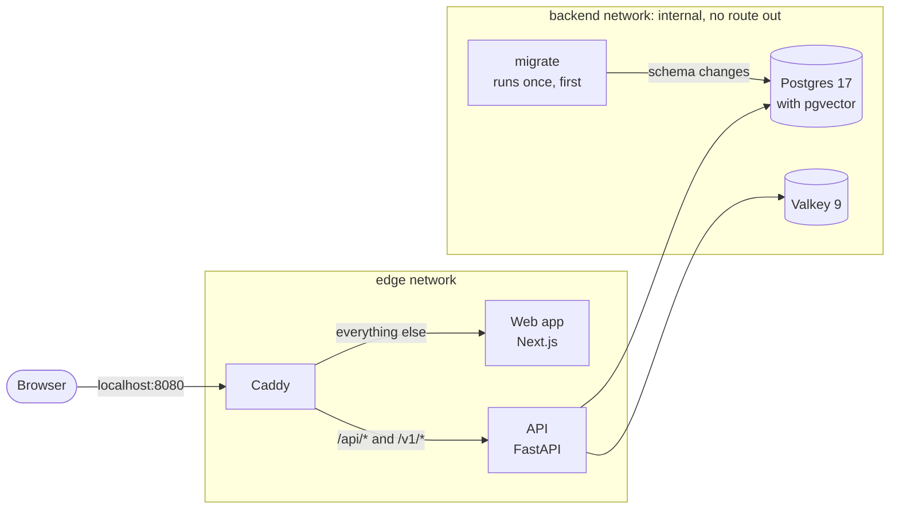

# Architecture

## Today

`make up` runs five containers behind one address, <http://localhost:8080>, after a sixth, `migrate`, has brought the database schema up to date and exited:

- **Caddy** is the only entry point, and the only container with a port on your machine. It sends `/api/*` and `/v1/*` to the API, and every other path to the web app. It passes streamed responses through at once, which the chat's token-by-token replies will need.
- **The API** is one Python application, `actio`, built on FastAPI. It runs as several processes from the same code, chosen with `--role`: `api` serves HTTP, and `migrate` applies database migrations and exits ([ADR 0008](adr/0008-postgres-through-sqlalchemy-and-psycopg.md)). Today the API serves its interactive docs, two probes, guest sessions and accounts:
    - `/api/healthz` answers whenever the process is alive;
    - `/api/readyz` answers 200 only when the database is reachable and migrated and Valkey answers. Otherwise it answers 503 and names what is missing;
    - `POST /api/session/guest` starts a session as a new guest and sets its cookie, `GET /api/me` says who the cookie belongs to, and `DELETE /api/session` ends it ([ADR 0009](adr/0009-sessions-in-the-database.md));
    - `POST /api/account` turns a guest into a lasting account with an email address and a password, `POST /api/session` logs in, `PUT /api/account/password` changes the password, and `DELETE /api/sessions` logs out of every browser ([ADR 0010](adr/0010-accounts-with-a-password.md));
    - new guests, sign-ups and password attempts are rate-limited. Past a limit, the answer is 429 with a `Retry-After` header ([ADR 0011](adr/0011-rate-limits-as-token-buckets-in-valkey.md));
    - `GET /api/conversations` lists your conversations a page at a time, and `GET /api/conversations/{id}` returns one with its messages. `PATCH` renames it, `DELETE` deletes it, and `PUT …/branch` shows another version of a question or an answer ([ADR 0012](adr/0012-conversations-as-a-tree-of-messages.md)). Nothing adds messages yet: that is the next step.
- **The web app** is a Next.js application. Today it is a placeholder page.
- **Postgres and Valkey** sit on an internal network. Only the API and the migration job can reach them, and they can't reach the internet. The API connects to both.
    - Postgres holds four tables: accounts, their sessions, conversations, and the messages of each conversation, which form a tree.
    - Valkey holds the rate limits' counters: one number per client address or email address that has made an attempt lately, under a hashed name.

Inside the API, the code is split into layers that only import downward, and a tool enforces it:

| Layer | Holds |
|---|---|
| `actio.api` | The HTTP interface: routes, the session cookie, the check against requests from other sites, which attempts are rate-limited, the error format. The only layer that knows the web framework |
| `actio.chat` | Conversations and their tree of messages: tables and rules, with no HTTP |
| `actio.identity` | Accounts and sessions: tables and rules, with no HTTP |
| `actio.core` | Settings, ids, the database connection and its migrations, the rate limiter |

| Path | Goes to |
|---|---|
| `/api/*` | The API: Actio's own endpoints, such as `/api/healthz` and `/api/docs` |
| `/v1/*` | The API: the gateway compatible with OpenAI and Anthropic (planned) |
| Everything else | The web app |

## Two ways to run it

- **`make up`** runs everything in containers, shaped like production. See [ADR 0005](adr/0005-container-images.md).
- **`make dev`** runs only Postgres, Valkey and Caddy in containers. The API and the web app run natively with hot reload, and Caddy reaches them through Docker Desktop. See [ADR 0004](adr/0004-local-development-stack.md).

## Security rules

The containers follow the same rules in both modes. Tests in `deploy/tests/` check them on every change:

- only Caddy publishes a port, and only on 127.0.0.1;
- every image is pinned by digest, including the base images of the images Actio builds;
- the data services sit only on the internal network;
- every container runs as a non-root user, on a read-only filesystem, without Linux capabilities, with a memory limit and a health check.

## Planned

The next phases add:

- **a worker process,** the same Python application run with `--role worker`, which takes background jobs from a queue in Postgres ([ADR 0001](adr/0001-one-app-several-process-roles.md));
- **models:** Ollama on your machine for local models, and cloud providers behind a router with fallbacks. In tests, [fakellm](reference/fakellm.md) stands in for all of them. The [clients](reference/llm.md) for Ollama and for OpenAI-compatible servers already exist as a package, with a command-line tool ([ADR 0007](adr/0007-local-models-through-ollamas-native-api.md)). The API doesn't call them yet, and the router isn't written;
- **usage limits:** session and weekly windows, enforced atomically in Valkey and recorded in a Postgres ledger. The [engine](reference/quota.md) already exists as a package, tested against a real Valkey server ([ADR 0006](adr/0006-usage-limits-engine.md)). Connecting it to the API, with the ledger, is still to come.

## Repository layout

| Path | Contents |
|---|---|
| `apps/api` | The Python application: the API today, plus the worker later |
| `apps/web` | The Next.js web app |
| `packages/fakellm` | A fake LLM server for tests, scripted by directives in the prompt |
| `packages/llm` | Model clients: a neutral chat format, adapters for Ollama and for OpenAI-compatible servers, and the `actio-llm` command |
| `packages/quota` | The usage-limits engine: Lua scripts for Valkey, and the Python reference model they're tested against |
| `compose.yaml`, `compose.dev.yaml` | The stack for `make up`, and the overlay for `make dev` |
| `deploy/` | Caddy's configuration, and the tests for the containers' rules |
| `docs/` | This site, including the decision records |
| `scripts/` | Developer scripts: tool checks, the denylist hook, the smoke test |
