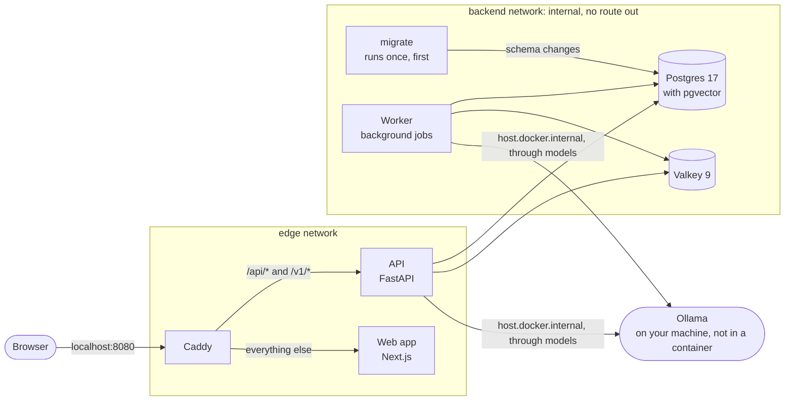

# Architecture

## Today

`make up` runs six containers, after a seventh, `migrate`, has brought the database schema up to date and exited. Five serve one address, <http://localhost:8080>; the sixth, the worker, runs the background jobs, and nothing reaches it. The API and the worker also share a third network, `models`, their way out to the models' servers:

- **Caddy** is the only entry point, and the only container with a port on your machine. It sends `/api/*` and `/v1/*` to the API, and every other path to the web app. It passes streamed responses through at once, which the chat's token-by-token replies need. A request to the API with a body over 2 MB it refuses itself, with a 413 in the API's own error format: a body that says its length before any of it is passed on, one sent in chunks once the limit is reached ([ADR 0023](adr/0023-answers-that-wait-their-turn.md)). What the API answers as JSON it compresses with gzip, for a client that takes it, once the body is over 512 bytes: a conversation goes out about three times smaller. An answer's stream it passes on as it is, and the web app's files are compressed by Next itself ([ADR 0004](adr/0004-local-development-stack.md), revision of 2026-11-22). Its configuration, `deploy/caddy/Caddyfile`, is built into its image, as the API's code is into the API's: after a change to it, `make up` or `make dev` again applies it, and a mistake in it stops the build while the running proxy goes on as it was.
- **The API** is one Python application, `actio`, built on FastAPI. It runs as several processes from the same code, chosen with `--role`: `api` serves HTTP, `migrate` applies database migrations and exits ([ADR 0008](adr/0008-postgres-through-sqlalchemy-and-psycopg.md)), `worker` runs background jobs (below), and `all` serves HTTP with the worker inside the same process, for the smallest installations and for `make dev`. Today the API serves its interactive docs, two probes, guest sessions and accounts:
    - `/api/healthz` answers whenever the process is alive;
    - `/api/readyz` answers 200 only when the database is reachable and migrated and Valkey answers, and, in a process that runs the worker inside it, that worker works. Otherwise it answers 503 and names what is missing;
    - `POST /api/session/guest` starts a session as a new guest and sets its cookie, `GET /api/me` says who the cookie belongs to, and `DELETE /api/session` ends it ([ADR 0009](adr/0009-sessions-in-the-database.md));
    - `POST /api/account` turns a guest into a lasting account with an email address and a password, `POST /api/session` logs in, `PUT /api/account/password` changes the password, and `DELETE /api/sessions` logs out of every browser ([ADR 0010](adr/0010-accounts-with-a-password.md));
    - new guests, sign-ups and password attempts are rate-limited. Past a limit, the answer is 429 with a `Retry-After` header ([ADR 0011](adr/0011-rate-limits-as-token-buckets-in-valkey.md));
    - `GET /api/conversations` lists your conversations a page at a time, and `GET /api/conversations/{id}` returns one with its messages. `PATCH` renames it, `DELETE` deletes it, and `PUT …/branch` shows another version of a question or an answer ([ADR 0012](adr/0012-conversations-as-a-tree-of-messages.md));
    - `POST /api/conversations/{id}/turns` puts a question to a model and streams the answer back, piece by piece, in the format the AI SDK reads. The first question creates the conversation. The same route rewords an earlier question, or asks for another answer. Each turn is recorded: which model, how it ended, what it cost in tokens and time, and when its first word came, by the API's own clock. The record also says about how many tokens of the model's window the conversation takes after the turn, worked out from what goes back to a model with the next question: its words, and not what it only thought ([ADR 0014](adr/0014-turns-streamed-in-the-ai-sdks-format.md));
    - a turn runs apart from the request that started it, in a task of its own. The request only reads along, and closing it ends nothing. `GET …/turns/{turn_id}/stream` reads along again from the answer's first event, and `POST …/turns/{turn_id}/cancel` stops the turn. Told to stop, the API gives the answers that are being written a moment, then records what is unfinished as interrupted. A turn that is being written says every 15 seconds that it is alive, and saves what its answer holds by then. If its process dies, the turn is given up on once it has been silent for a minute, when someone looks at its conversation or the worker comes by: as interrupted, with what it had saved as its answer ([ADR 0022](adr/0022-turns-that-run-apart-from-their-request.md));
    - `GET /api/models` lists the models on offer, from `config/models.toml`, and says whether each can answer right now: `ready`, `missing` from its server, or its server `unreachable` ([ADR 0013](adr/0013-the-models-on-offer-are-a-file.md)). A model may name others that stand in for it, which it lists too: it is `ready` when one of them is. A question's start alone uses what a server said of a model less than five minutes ago without waiting, while some model of the question's chain is ready by it, and has the servers asked again behind it. Nothing is refused by what a server said more than 15 seconds ago ([ADR 0028](adr/0028-a-model-names-those-that-stand-in-for-it.md), revision "a status that is known isn't waited for");
    - a model that can't answer, before the first word or thought of an answer, is answered for by those it names, in order: its server away, too busy, at a limit, or refusing the request. One that isn't ready is passed over, and so is one whose room, its window or what its server takes in a minute, whichever is less, is smaller than the request by Actio's guess, while another of them has room for it: a guess never refuses a turn ([ADR 0029](adr/0029-a-model-is-passed-over-for-a-request-too-large.md)). One whose provider's plan, by what Actio counted of the requests and tokens it sent the model in the last minute and day, has nothing left for the request is asked after those that have budget, and so is one whose provider refused a request with 429 and named a wait longer than the 2 seconds the walk waits out itself, until that wait is over, a day at the most: each process keeps that wait beside the model's breaker. When none of those with room has any, the turn is refused for now, before anything of it is kept: 429, with how long to wait and the model asked ([ADR 0030](adr/0030-the-providers-budgets-are-counted.md)). One that failed half or more of its last tries, five at the least within half an hour, is asked after those that aren't failing, of those with budget and of those without, for 30 seconds to five minutes, and then one request tries it in its place again: each process keeps a breaker for each model on a provider, which every try feeds, and nothing is refused for it, so that a chain's only model is asked as ever ([ADR 0031](adr/0031-a-model-that-keeps-failing-is-asked-last.md)). Each is asked as itself, with its own window and behind its own gate, given back before the next one's is waited at. After the first word nothing moves on. The turn stays the asked model's, at its price, and its record says which model answered, as the log does: the page says it under the answer ([ADR 0028](adr/0028-a-model-names-those-that-stand-in-for-it.md));
    - `POST /api/models/{id}/warm-up` has a model's server load it into memory ahead of the first question to it, and answers at once: 202 while it loads, 204 when there is nothing to load. Ollama can be asked to; a server that speaks OpenAI's API can't. The load is the request a question would be, without the question, so that the server doesn't load the model again for the question after it; it isn't asked while the server writes as many answers as it takes, and it never waits at the gate below ([ADR 0026](adr/0026-models-loaded-ahead-of-the-first-question.md));
    - a model's server writes only so many answers at once: Ollama one, unless the models file says otherwise. A turn that comes while its server is busy waits its turn inside the API, at a gate in front of the server, running like any other, and its model is asked once there is room. A place that comes free goes to the account that has had the least: the one that holds the fewest places there, then the one given a place there the longest ago; one account's own answers pass in the order they were asked, and a title waits as its conversation's account's ([ADR 0023](adr/0023-answers-that-wait-their-turn.md));
    - a turn costs credits, and an account has only so many per session and per week, from `config/plans.toml`. The most a turn can cost is held before a model is asked; a turn that doesn't fit is answered 429, with the moment the limit starts over. `GET /api/usage` says how much is used ([ADR 0020](adr/0020-usage-limits-on-turns.md));
    - a plan also says how many answers one account may have being written at once, and one more is answered 429, before anything is kept. An account reads along with an answer in six places at once at most: one more join is answered 429 too ([ADR 0023](adr/0023-answers-that-wait-their-turn.md)).
- **The worker** is the same application, run with `--role worker`, in a container of its own from the API's image. `make dev` runs it inside the API's process instead, with `--role all`, and it reloads with the API ([ADR 0024](adr/0024-background-jobs-in-a-queue-in-postgres.md)).
    - It runs background jobs from a queue in Postgres, Procrastinate's, one at a time. A job is deferred in the transaction of the change it follows, so the two are committed together, or not at all.
    - A job can also have a schedule. Today five jobs have one: four every ten minutes, and one every hour. The worker deletes expired guests and sessions, which the API otherwise deletes only after a new guest arrives. It gives up on answers that have been silent for a minute, because the process writing them died, keeping what each had saved, which the API otherwise does only when someone looks at their conversation. It never waits for a lock: an answer whose conversation someone is reading, or asking in, it leaves for its next run ([ADR 0022](adr/0022-turns-that-run-apart-from-their-request.md)). It counts in Valkey what the API wrote to the usage ledger and couldn't count there, because Valkey didn't answer or the process died in between ([ADR 0020](adr/0020-usage-limits-on-turns.md)). And it looks after its own queue: a job that a worker which died had in hand is run again, that worker is taken off the queue's list, and a job that ended without succeeding is deleted after a week. Every hour, at five past, it compares the usage counters in Valkey with the ledger, account by account, and says in its log how far apart they are: an answer written while an account's counters were lost and rebuilt leaves them short until they are next rebuilt. It repairs nothing.
    - A sixth job has no schedule: the first turn of a conversation that completes defers it, when `config/models.toml` names a model for titles. The worker asks that model for a title of a few words, from the conversation's first question, or those that stand in for it when it can't answer, and writes it in place of the first line, unless someone has renamed the conversation meanwhile. It costs the account nothing ([ADR 0025](adr/0025-titles-written-by-a-model.md)). A title the model couldn't give for now, because its server didn't answer or failed, or the title took longer than 30 seconds, is asked for again after half a minute, two minutes and ten; one the model won't give is not. Until the title is there, and for 15 seconds at most after the model was asked, the list of conversations says that it is on its way, and the page reads the list again until it no longer does. So the worker reads the models file too, as the API does, and reaches the models' servers: through the `models` network in its container, its one way out, and at the API's own gate inside the API's process.
    - A job may run more than once, from its start each time: after a stop cut it off, after the worker that had it died, or, after a wait, when it failed with an error that its listing names as worth another try. Three times more at most, whatever the reason. A job that fails with any other error is not run again.
    - It starts after the migration, and checks for itself that the database is at the migration its code expects. When it isn't, the worker takes no job, and ends with one line that says so.
    - Told to stop, by SIGTERM or Ctrl-C, it lets the job in hand finish for up to 15 seconds, then cuts it off and puts it back into the queue, and ends well, whenever it is told. A second signal changes nothing. Docker gives it 25 seconds.
    - It lives through a restart of the database: it stops, starts again a second later, and waits for the database as when it first started. When it can't go on, as 30 seconds after it lost its database, it ends, and Docker starts it again.
    - It has no port for Docker to probe. While it works it touches a file every five seconds, and its health check says whether it did so lately.
    - Inside the API's process, it never ends that process: when it can't work, it says why in the log and tries again ten seconds later. It is told to stop at the same moment as the answers being written. There `/api/readyz` says whether it works: `not working` before it has first said so, from the moment it ends with an error or can't work until it says so again, and 20 seconds after it last did, by the rule its health check has for the file.
- **Ollama** runs the local models. It runs on your machine itself, where it can use the graphics processor, and the API and the worker reach it from their containers.
- **The web app** is a Next.js application: the chat ([ADR 0015](adr/0015-the-web-chat-calls-the-api-from-the-browser.md)).
    - **Its server sends only the frame of the page.** Everything of yours is fetched by the browser, straight from the API, with the session cookie. Nothing but the API handles a session.
    - **A first visit starts a guest session,** so you can ask at once. `/` is a new conversation, and `/c/<id>` a stored one.
    - **The list of your conversations is beside the chat,** to open, rename and delete them. The page reads it from the API again after every turn, and every second while the API says that a conversation's title is on its way, and never rearranges it by itself ([ADR 0018](adr/0018-the-list-of-conversations-is-the-servers.md)).
    - **Signing up, logging in and the account are places in the same screen,** at `/signup`, `/login` and `/account`. What the page has read for one session is dropped when that session ends, so the next one starts with nothing of it ([ADR 0019](adr/0019-accounts-in-the-one-screen.md)).
    - **An answer streams into the page** through the AI SDK's `useChat`. You can stop it, try a failed one again, reword a question that got no answer, and have the model show its reasoning.
    - **Only Stop ends an answer:** the page then asks the API to stop the turn. Leaving the conversation, or the page, ends the reading and nothing else.
    - **An answer that is still being written is read along with** wherever the conversation is opened: after a reload, on coming back to it, in a second window. The page joins the turn's stream, from the answer's first word, and Stop works there too. When the stream can't be read, the page says that the answer is on its way, and looks until it is done ([ADR 0022](adr/0022-turns-that-run-apart-from-their-request.md)).
    - **The server is the truth.** When an answer ends any other way than well, the page reads the conversation again and shows what is stored.
    - **Under an answer that has ended, one line says what it took:** how fast the model wrote, how long the first word took, and what it cost. The figures are the turn's record; the page only divides and words them ([ADR 0015](adr/0015-the-web-chat-calls-the-api-from-the-browser.md), revision "an answer says what it took").
    - **Under the box, one line says how full the model's window is** in the conversation, as in "39% full · 3,214 of 8,192 tokens", and from 90 % that a new chat is due soon. The figure is the server's, from the record of the newest turn that has one; the page divides it by the window of the model that answers, and says nothing of another model's figure ([ADR 0015](adr/0015-the-web-chat-calls-the-api-from-the-browser.md), revision "the page says how full the model's window is").
    - **The model that answers is loaded ahead.** Once the page knows that model, and when something is written into the box, it asks the API to have the model's server load it, at most once a minute, and says nothing of it: a local model's server lets a model go five minutes after its last request, and the next question would wait seconds for the load ([ADR 0026](adr/0026-models-loaded-ahead-of-the-first-question.md)).
    - **The usage limits are the server's to count.** A meter under the list shows what the API said was used, read again after every turn. That a limit is reached, the page learns from a question being refused; it then says how long to wait, sends nothing meanwhile, and offers a model that costs nothing where there is one ([ADR 0021](adr/0021-usage-limits-in-the-page.md)).
    - **An answer is shown as the markdown it is written in:** headings, tables, coloured code, formulas and diagrams. It is a model's text, so it can do nothing else: HTML in it is shown as text, no picture is fetched, and a link opens only after you have seen its address ([ADR 0016](adr/0016-answers-shown-as-markdown.md)).
    - **Light or dark is yours to choose,** under the list: as your system is set, the default, light or dark. The choice is your browser's, kept in its storage, and shown from the page's first paint ([ADR 0015](adr/0015-the-web-chat-calls-the-api-from-the-browser.md), revision "the reader chooses light or dark").
    - **Its types for the API are generated** from the API's recorded description, `apps/api/openapi.json`, so a change to the API that the page doesn't follow fails to compile.
- **Postgres and Valkey** sit on an internal network. Only the API, the migration job and the worker can reach them, and they can't reach the internet. The API and the worker connect to both.
    - Postgres holds seven tables: accounts, their sessions, conversations, the messages of each conversation, which form a tree, the turns in which a model answered, the usage ledger: what each turn used, in rows that are only ever added, and beside it a note for each of those rows that the usage counters haven't been told of yet. Beside them is the queue of background jobs, in Procrastinate's own tables.
    - Valkey holds what is counted fast: the rate limits' counters, one number per client address or email address that has made an attempt lately, under a hashed name; each account's usage counters, with the credits held for answers being written; and the budgets of the models whose providers' limits the models file states, one number for each limit of a model that has been sent something lately, under the provider's name and the model's.
    - Valkey also holds what each running turn streams, in a stream of its own, so that an answer can be read by more than one reader and from its beginning. A stream is deleted a minute after its turn has ended.
    - Valkey keeps nothing on disk. After a restart the rate limits and the models' budgets start full, and an account's usage counters are rebuilt from the ledger the next time they are needed. An answer that was being written is finished unread, and stored as ever.

Inside the API, the code is split into layers that only import downward, and a tool enforces it:

| Layer | Holds |
|---|---|
| `actio.api` | The HTTP interface: routes, the session cookie, the check against requests from other sites, which attempts are rate-limited, the error format. The only layer that knows the web framework |
| `actio.worker` | The worker: every background job it runs, with what each needs, and their schedules. Beside `actio.api`: neither imports the other |
| `actio.chat` | Conversations, their tree of messages, and turns: starting one, following a model's answer as it streams, recording how it ended and what it cost. Running turns apart from their requests, the stream of what each writes, and how many answers and readers one account has at once. The titles a model writes for conversations. Tables and rules, with no HTTP |
| `actio.catalog` | The models on offer: reading `config/models.toml`, asking a model's server about it, which models stand in for it and which of them are ready, which of those are asked for a request, and in which order, by their room, their budget, the wait their provider named and whether they keep failing, counting what a request takes of a model's budget, recording each try of a model in its breaker and the wait its provider names, having it load a model ahead of a question, and the gate where answers wait while that server is busy |
| `actio.identity` | Accounts and sessions: tables and rules, with no HTTP |
| `actio.usage` | Usage limits: reading `config/plans.toml`, holding credits before a request and counting them after it through the [engine](reference/quota.md), the ledger, counting again what the counters missed, and comparing the counters with the ledger |
| `actio.core` | Settings, ids, the database connection and its migrations, the queue of background jobs, the file the worker touches while it works and the health check that reads it, the rate limiter, the counters of the providers' budgets, what a process holds open while it runs (its database pool, its Valkey client, and the usage limits' engine and the budgets' counters on it, built once for the API and the worker), reading a file in `config/`, hearing the signal that stops the process |

| Path | Goes to |
|---|---|
| `/api/*` | The API: Actio's own endpoints, such as `/api/healthz` and `/api/docs` |
| `/v1/*` | The API: the gateway compatible with OpenAI and Anthropic (planned) |
| Everything else | The web app |

## Two ways to run it

- **`make up`** runs everything in containers, shaped like production. See [ADR 0005](adr/0005-container-images.md).
- **`make dev`** runs only Postgres, Valkey and Caddy in containers. The API and the web app run natively with hot reload, and Caddy reaches them through Docker Desktop. The worker runs inside the API's process, and reloads with it. See [ADR 0004](adr/0004-local-development-stack.md).

## Security rules

The containers follow the same rules in both modes. Tests in `deploy/tests/` check them on every change:

- only Caddy publishes a port, and only on 127.0.0.1;
- every image is pinned by digest, including the base images of the images Actio builds;
- the data services sit only on the internal network;
- every container runs as a non-root user, on a read-only filesystem, without Linux capabilities, with a memory limit and a health check;
- only the worker is started again by Docker, and only when it failed.

## Planned

The next phases add:

- **more providers:** the rest of the router, and a way to choose between models. Groq's and the Gemini API's can be offered in the models file already, each under a name of its own ([ADR 0027](adr/0027-cloud-models-through-their-openai-compatible-layers.md)), and a model can name others that are asked in its place when it can't answer before its first word ([ADR 0028](adr/0028-a-model-names-those-that-stand-in-for-it.md)). A model whose failure may be gone in a moment is asked once more first, and a provider may say how long its server is given to begin an answer (ADR 0028, revision of 2026-11-25). A model that keeps failing is asked after the others of its chain for a while ([ADR 0031](adr/0031-a-model-that-keeps-failing-is-asked-last.md)). Still to come: the wait a provider names heeded by the breaker, and what the list of models and the page say of a model that keeps failing. In tests, [fakellm](reference/fakellm.md) stands in for all of them, beside recordings of those two. The router will also say when an answer waits for its server, and how many are ahead of it.

## Repository layout

| Path | Contents |
|---|---|
| `apps/api` | The Python application: the API and the worker |
| `apps/web` | The Next.js web app: the chat's pages and components, its calls to the API, and their tests |
| `packages/fakellm` | A fake LLM server for tests, scripted by directives in the prompt |
| `packages/llm` | Model clients: a neutral chat format, adapters for Ollama and for OpenAI-compatible servers, Groq and the Gemini API among them, the walk down a chain of models that stand in for each other, the circuit breaker that says whether a model keeps failing, a guess at a text's tokens, and the `actio-llm` command |
| `packages/quota` | The usage-limits engine: Lua scripts for Valkey, and the Python reference model they're tested against |
| `compose.yaml`, `compose.dev.yaml` | The stack for `make up`, and the overlay for `make dev` |
| `config/` | What an installation changes without touching code. Today: `models.toml`, the models on offer, and `plans.toml`, what they cost and how much each kind of account may use; and `examples/free-cloud/`, a pair of the two to copy, which offers Groq's and the Gemini API's models beside the shipped one |
| `deploy/` | Caddy's configuration and the image it is built into, and the tests for the containers' rules |
| `docs/` | This site, including the decision records |
| `scripts/` | Developer scripts: tool checks, the denylist hook, the smoke test |
